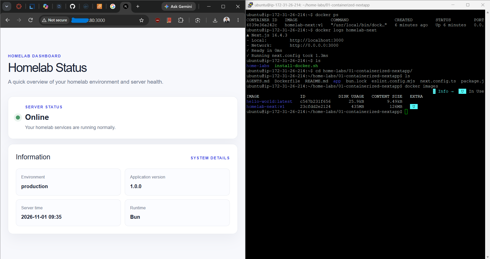

# Lab 01: Containerized Next.js App on AWS EC2

A deep dive into Docker architecture, multi-stage layer caching, image size optimization, and deploying a containerized Next.js (App Router + Bun) application to an Ubuntu Linux VM on AWS EC2.

---

## Overview & Lab Objectives

The goal of this lab was to move beyond basic container commands and master production-grade containerization workflows from first principles:

1. **Understand Docker internals**: Explore client-server architecture, Docker daemon, container runtime, layers, and UnionFS caching mechanisms.
2. **Optimize container builds**: Implement a multi-stage Dockerfile using the Bun runtime and Next.js `standalone` output mode to maximize build-cache hits and minimize production image size.
3. **Automate host setup**: Write and execute a reproducible Bash provisioning script (`install-docker.sh`) on a fresh Ubuntu EC2 instance.
4. **Deploy & expose safely**: Run the container in production mode with a non-root user and configure AWS Security Group inbound traffic rules to access the application publicly over port 3000.

---

## Key Architecture & Concepts

### 1. Docker Under the Hood
Docker is not a virtual machine—it utilizes Linux kernel features (namespaces for isolation and cgroups for resource constraints) to run isolated processes:
- **Docker Client & Daemon**: The Docker CLI communicates with the background `dockerd` service over a Unix socket or REST API.
- **Layer Immutability & Caching**: Each instruction in a Dockerfile creates a read-only layer. Docker reuses cached layers if preceding instructions and copied file hashes remain unchanged.
- **Why file order matters**: Placing frequently changing files (like application source code) after infrequently changing files (like dependency manifests) prevents cache busts on every build.

### 2. Multi-Stage Build Strategy
Instead of shipping build tools, TypeScript compilers, and massive development dependencies into the runtime image, this lab uses a 4-stage pipeline:

```
[ oven/bun:1.4.4-debian ] -> (base)
                               |
               +---------------+---------------+
               |                               |
          (deps stage)                 (builder stage)
       Copies lockfiles &            Compiles Next.js app
        installs packages              using standalone mode
               |                               |
               +---------------+---------------+
                               |
                        (runner stage)
                     Copies ONLY standalone
                    server, public assets &
                     runs with non-root user
```

- **`base`**: Defines the consistent base image (`oven/bun:1.4.4-debian`) and working directory `/app`.
- **`deps`**: Copies only `package.json` and `bun.lock` to run `bun install --frozen-lockfile`. This layer stays cached unless dependencies change.
- **`builder`**: Imports installed `node_modules` from `deps`, pulls the project source, and executes `bun run build`. Next.js standalone mode extracts only the code and dependencies required for execution into `.next/standalone`.
- **`runner`**: Minimal runtime container. Only copies `.next/standalone`, static assets (`.next/static`), and `public/`. Runs as unprivileged user `bun` on port 3000.

### 3. Preventing Cache Invalidation with `.dockerignore`
Files like local `.next/`, `node_modules/`, `.git/`, `.env*`, and local logs are excluded from the Docker context via `.dockerignore`. This keeps the build context small, preserves secrets, and ensures the Docker daemon only evaluates necessary files.

---

## Project Structure

```text
01-containerized-nextapp/
├── .dockerignore        # Excludes local artifacts, node_modules, and secrets
├── Dockerfile           # Optimized 4-stage multi-stage build (Bun + Next.js)
├── README.md            # Lab documentation and walkthrough
├── app/                 # Next.js App Router source (Homelab Status dashboard)
│   ├── globals.css      # Custom styling
│   ├── layout.tsx       # Root layout
│   └── page.tsx         # Homelab status dashboard
├── bun.lock             # Bun lockfile for reproducible builds
├── install-docker.sh    # Ubuntu automated Docker Engine installation script
├── next.config.ts       # Standalone build output configuration
├── package.json         # Project metadata and dependencies
└── tsconfig.json        # TypeScript configuration
```

---

## Step-by-Step Implementation Workflow

### Step 1: Configure Standalone Output in Next.js
In [next.config.ts](./next.config.ts), standalone output mode is enabled:

```typescript
const nextConfig: NextConfig = {
  output: "standalone",
  // ... other configurations
};
```

This instructs Next.js during build to trace dependencies and create a lightweight bundle at `.next/standalone` with its own `server.js`, eliminating the need to bundle the entire `node_modules` folder in the final image.

---

### Step 2: Crafting the Multi-Stage `Dockerfile`
The [Dockerfile](./Dockerfile) implements efficient layer caching and least-privilege security:

```dockerfile
# 1. Base stage
FROM oven/bun:1.4.4-debian AS base
WORKDIR /app

# 2. Dependencies stage (cached unless package.json/bun.lock change)
FROM base AS deps
COPY ["package.json", "bun.lock", "./"]
RUN bun install --frozen-lockfile

# 3. Builder stage (compiles application)
FROM base AS builder
COPY --from=deps /app/node_modules ./node_modules
COPY . .
RUN bun run build

# 4. Production runner stage
FROM base AS runner
COPY --from=builder --chown=bun:bun /app/.next/standalone ./
COPY --from=builder --chown=bun:bun /app/.next/static ./.next/static
COPY --from=builder --chown=bun:bun /app/public ./public

ENV NODE_ENV=production
ENV HOSTNAME=0.0.0.0
ENV PORT=3000

EXPOSE 3000

# Run as non-root user for security
USER bun

CMD ["bun", "server.js"]
```

#### Deep Dive: Understanding the Dockerfile Instructions & Mechanics

##### 1. Why Use Stages (`AS <stage_name>`)?
In a standard single-stage Dockerfile, every dependency, compilation tool, TypeScript compiler, and cached file remains permanently trapped inside the final image. This can cause images to bloat to over 1GB and increases the attack surface with unnecessary development tooling.

With **Multi-Stage Builds**:
- Each `FROM` instruction starts a fresh, isolated environment (a "stage").
- You can name stages using `AS <name>` (for example, `AS base`, `AS deps`, `AS builder`, `AS runner`).
- You can inherit from another stage (`FROM base AS deps`).
- **Crucial benefit**: Only the **final stage (`runner`)** is saved as the production image! All previous stages (`deps`, `builder`) and their temporary files are automatically discarded once the build finishes.

##### 2. The Power of `COPY --from=<stage>`
Normally, the `COPY` instruction copies files from your host machine into the container image:
```dockerfile
COPY . .  # Copies from your host into the container
```
When you add the `--from=<stage>` flag, Docker instead copies files **from an earlier stage** into the current stage:
```dockerfile
# Copy installed dependencies from the 'deps' stage:
COPY --from=deps /app/node_modules ./node_modules

# Copy only the compiled standalone server from the 'builder' stage:
COPY --from=builder /app/.next/standalone ./
```
This is the superpower of multi-stage builds: you do your heavy compiling in one stage, and then cherry-pick *only* the compiled outputs into your lean production stage, leaving all the source code, compilers, and dev dependencies behind.

##### 3. File Ownership with `--chown=bun:bun`
By default, Docker copies files with `root:root` ownership. If your container later runs as an unprivileged user (like `USER bun`), that user might not have permission to read or execute those files.

Adding `--chown=bun:bun` to the `COPY` command:
```dockerfile
COPY --from=builder --chown=bun:bun /app/.next/standalone ./
```
instantly sets the file owner and group to `bun` during the copy operation, preventing permission errors without needing to run an extra `RUN chown -R bun:bun ...` layer (which would double the layer size).

##### 4. Line-by-Line Breakdown of Other Key Instructions

| Instruction | What It Does In This Project |
| :--- | :--- |
| **`FROM oven/bun:1.4.4-debian AS base`** | Sets the official lightweight Bun Debian image as our shared base foundation. |
| **`WORKDIR /app`** | Sets `/app` as the active working directory. If it does not exist, Docker automatically creates it. All following commands (`RUN`, `COPY`, `CMD`) run inside this path. |
| **`COPY ["package.json", "bun.lock", "./"]`** | Copies only the dependency manifests first. Using JSON array syntax safely handles filenames with spaces or special characters. |
| **`RUN bun install --frozen-lockfile`** | Executes during image build time. The `--frozen-lockfile` flag guarantees Bun strictly installs what is locked in `bun.lock` without updating dependencies, ensuring 100% reproducible builds. Because this happens before copying the rest of the source code, Docker reuses this cached layer whenever code changes but dependencies don't. |
| **`RUN bun run build`** | Runs the Next.js compilation step inside the `builder` stage, generating the optimized `.next/standalone` bundle. |
| **`ENV NODE_ENV=production`** | Sets environment variables that persist both at build time and inside the running container. |
| **`ENV HOSTNAME=0.0.0.0`** | Instructs the Node/Bun server to listen on all network interfaces (`0.0.0.0`) instead of just `localhost` (`127.0.0.1`), allowing external traffic from AWS EC2 to reach the app. |
| **`ENV PORT=3000`** | Sets the default application port to 3000. |
| **`EXPOSE 3000`** | Documents that the container listens on port 3000 at runtime. It serves as documentation for developers and container orchestrators. |
| **`USER bun`** | Switches execution from the default root user to the non-root `bun` user. Adhering to the **principle of least privilege**, this ensures that if the application has a vulnerability, an attacker cannot compromise the underlying host system with root privileges. |
| **`CMD ["bun", "server.js"]`** | Specifies the default command executed when the container starts. Unlike `RUN` (which executes while *building* the image), `CMD` executes when *running* the container. Using the **exec form** (JSON array format) runs the process directly as PID 1 without an intermediate shell, allowing Unix signals like `SIGTERM` and `SIGINT` to be handled properly for graceful shutdowns. |

---

### Step 3: Provisioning an AWS EC2 Ubuntu Instance
1. Log in to the **AWS Management Console** and navigate to **EC2 Dashboard**.
2. Click **Launch Instance**:
   - **Name**: `homelab-docker-node` (or preferred name)
   - **AMI**: Ubuntu Server 24.04 LTS (or 22.04 LTS)
   - **Instance Type**: `t2.micro` or `t3.micro` (Free-tier eligible)
   - **Key Pair**: Select or create an SSH key pair (`.pem`)
   - **Network Settings**: Ensure "Auto-assign public IP" is enabled.
3. Launch the instance and retrieve its **Public IPv4 Address**.

---

### Step 4: Connecting & Setting up Docker via `install-docker.sh`
1. Connect to the EC2 instance via SSH:
   ```bash
   ssh -i /path/to/your-key.pem ubuntu@<EC2_PUBLIC_IP>
   ```

2. Clone the repository and navigate into this lab directory:
   ```bash
   git clone https://github.com/ImJanindu/home-labs.git
   cd home-labs/01-containerized-nextapp
   ```

3. Run the automated Docker provisioning script [install-docker.sh](./install-docker.sh):
   ```bash
   chmod +x install-docker.sh
   ./install-docker.sh
   ```

   **What the script automates:**
   - Updates APT package lists and runs non-interactive system upgrades.
   - Cleans out conflicting legacy packages (`docker.io`, `containerd`, `runc`).
   - Imports official Docker GPG keys into `/etc/apt/keyrings/docker.asc`.
   - Adds the official Docker apt repository for the system architecture.
   - Installs `docker-ce`, `docker-ce-cli`, `containerd.io`, `docker-buildx-plugin`, and `docker-compose-plugin`.
   - Enables and starts the Docker systemd daemon service.
   - Adds the current user (`ubuntu`) to the `docker` group to enable running Docker commands without `sudo`.
   - Runs a verification `hello-world` test container.

4. Apply the new group membership (or re-login):
   ```bash
   newgrp docker
   ```

---

### Step 5: Building and Running the Container

#### 1. Build the Docker Image
From inside `01-containerized-nextapp`, build the Docker image with the tag `homelab-next:v1`:

```bash
docker build -t homelab-next:v1 .
```

*Observe the build output: Notice how `deps` layers stay cached on subsequent builds when only source files in `app/` are modified.*

#### 2. Run the Container with Runtime Environment Variables
Because `.env*` files are intentionally excluded in `.dockerignore` (to prevent secrets and sensitive configuration from being permanently baked into immutable image layers), the container has no access to local `.env.local` files by default.

To supply production configuration values to the Next.js runtime, pass them dynamically using the `-e` (or `--env`) flag at runtime:

```bash
docker run -d \
  --name homelab-next \
  --restart unless-stopped \
  -p 3000:3000 \
  -e APP_ENV=production \
  -e APP_VERSION=1.0.0 \
  homelab-next:v1
```

**Breakdown of the run command:**
- `-d`: Detached mode (runs container in the background).
- `--name homelab-next`: Assigns a clean, human-readable name to the container instead of a random hash.
- `--restart unless-stopped`: Ensures the container restarts automatically if it crashes or if the EC2 VM reboots.
- `-p 3000:3000`: Maps port `3000` on the EC2 host to port `3000` inside the container.
- `-e APP_ENV=production`: Injects the environment variable so the dashboard reflects `Production`.
- `-e APP_VERSION=1.0.0`: Injects the application version.
- `homelab-next:v1`: The target image and version tag to instantiate.

#### 3. Verify Container Status & Logs
Check that the container is healthy and actively serving requests:

```bash
# Check running containers
docker ps

# Follow live container logs
docker logs -f homelab-next
```

---

### Step 6: Configuring AWS Security Group (Inbound Rule)
By default, EC2 security groups only permit inbound SSH traffic on port 22. To reach the Next.js server on port 3000:

1. In the **AWS EC2 Console**, navigate to **Instances** and select your running instance.
2. In the details pane below, switch to the **Security** tab and click on the associated **Security Group ID**.
3. Under **Inbound Rules**, click **Edit inbound rules**.
4. Click **Add rule** with the following parameters:
   - **Type**: Custom TCP
   - **Port range**: `3000`
   - **Source**: `0.0.0.0/0` (Anywhere IPv4, or choose `My IP` for restricted access)
   - **Description**: `Next.js Homelab App`
5. Click **Save rules**.

---

### Step 7: Verifying Public Access
Open your web browser and navigate to:

```text
http://<EC2_PUBLIC_IP>:3000
```

You will see the live **Homelab Status** dashboard reporting real-time server health, environment details (`Production`), application version (`1.0.0`), runtime (`Bun`), and server timestamp directly served from the containerized application on your EC2 VM.



---

## Useful Docker Commands Reference

| Command | Description |
| :--- | :--- |
| `docker build -t homelab-next:v1 .` | Build the image tagged as `homelab-next:v1` |
| `docker run -d -p 3000:3000 --name homelab-next -e APP_ENV=production homelab-next:v1` | Run container named `homelab-next` in background with environment variables |
| `docker ps` | List all running containers |
| `docker ps -a` | List all containers including stopped ones |
| `docker logs -f homelab-next` | Follow live logs from the `homelab-next` container |
| `docker stop homelab-next` | Gracefully stop the `homelab-next` container |
| `docker rm homelab-next` | Remove the stopped `homelab-next` container |
| `docker images` | Inspect local Docker images and their sizes |
| `docker system df` | Show Docker disk usage (images, containers, build cache) |
| `docker system prune -f` | Clean up unused build cache and stopped containers |

---

## Lessons Learned & Key Takeaways

- **Build Cache Optimization**: Splitting dependency installation from source code compilation dramatically speeds up iterative builds. Code updates take seconds to build because dependencies remain cached.
- **Standalone Mode Impact**: Copying `.next/standalone` produces a drastically smaller image footprint compared to copying the full workspace or `node_modules`.
- **Runtime Environment Injection**: Excluding `.env*` files in `.dockerignore` is best security practice to avoid leaking secrets in image layers. Injecting variables at runtime via `-e` or `--env-file` ensures the image remains environment-agnostic and configurable across staging or production.
- **Reproducible Scripting**: Utilizing an idempotent setup script like `install-docker.sh` eliminates manual host configuration errors and standardizes new VM provisioning.
- **Security Group Essentials**: Cloud firewalls operate independently of host firewalls (`ufw`/`iptables`); ensuring the cloud provider's ingress rules match the container host port mapping is critical for accessibility.

---

## Navigation & Next Steps

- ➡️ **Next Lab**: [Lab 02: Nginx Reverse Proxy with Docker Compose](../02-nginx-reverse-proxy/README.md) — Learn how to place an Nginx reverse proxy in front of this containerized Next.js app using Docker Compose, isolating port 3000 from the public internet and serving traffic seamlessly over standard HTTP port 80.
- 🏠 **Home**: [Home Labs Overview](../README.md)

