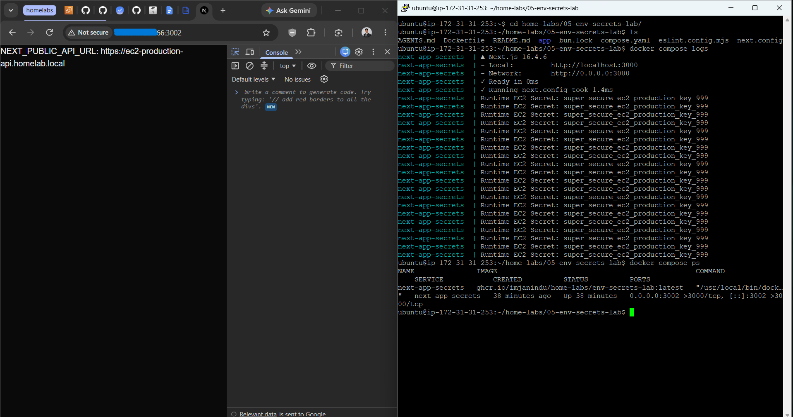

# Lab 05: Managing Production Secrets and Environment Variables in Next.js

A comprehensive guide to securely handling public configuration and private API secrets in a containerized Next.js application using Docker, GitHub Actions, and AWS EC2.

## 🎯 Overview & Lab Objectives

The goal of this lab was to establish industry-standard security practices for environment variables in a CI/CD pipeline:

1. **Isolate Secrets:** Ensure private keys (like database passwords) are never baked into Docker images or pushed to GitHub.
2. **Build-Time Injection (Public):** Compile public API URLs directly into the client-side JavaScript using GitHub Actions and Docker build arguments.
3. **Runtime Injection (Private):** Inject secure, host-resident secrets into the running container on the EC2 instance using Docker Compose.
4. **Master Next.js Rendering:** Navigate Partial Prerendering (PPR) and `<Suspense>` boundaries to prevent static build failures when accessing dynamic runtime secrets.

## 🏗️ Architecture & Request Flow

```text
1. BUILD PHASE (GitHub Actions)
   Next.js Compiler receives NEXT_PUBLIC_ variables via Docker ARG/ENV
   Compiler bakes public variables into static HTML/JS files
   Image is pushed to GHCR (Zero private secrets included)

2. DEPLOYMENT PHASE (EC2 Host)
   Docker Compose pulls the environment-agnostic image
   Docker Compose reads local .env.production file on EC2
   Docker Compose injects keys directly into the container's isolated memory

3. RUNTIME PHASE (Next.js Server)
   Browser requests page -> Sees only public baked-in variables
   Next.js Node server executes -> Securely reads private variables from memory
```

## 📁 Project Structure

```text
.github/
└── workflows/
    └── lab05-env-secrets.yml    # CI/CD pipeline for this specific lab
05-env-secrets-lab/
├── .env.local                   # Local development secrets (ignored by Git)
├── compose.yaml                 # Maps the production secrets into the container
├── Dockerfile                   # 4-stage build utilizing ARG and ENV
└── app/
    └── page.tsx                 # Next.js UI with Suspense boundaries
```

## 🧠 Deep Dive: Environment Variable Mechanics

Understanding how Docker and Next.js interact with environment variables is critical for preventing security leaks.

### 1. Build-Time Injection for Public Variables (`ARG` and `ENV`)
Next.js strictly enforces that any variable starting with `NEXT_PUBLIC_` must be hardcoded into the client-side JavaScript bundles. This happens exactly when `bun run build` executes. 

Because GitHub Actions builds the image on a remote runner, it does not have access to your server's `.env` files. If you do not pass the public URL into the build process, Next.js will compile the frontend with empty strings.

This is solved in the `Dockerfile` using `ARG` and `ENV`:
*   **`ARG NEXT_PUBLIC_API_URL`**: This opens a temporary channel for GitHub Actions to pass data into the Docker build process via the `build-args` parameter. However, `ARG` values are strictly for Docker's internal use and are invisible to the commands running inside the container.
*   **`ENV NEXT_PUBLIC_API_URL=$NEXT_PUBLIC_API_URL`**: This takes the value captured by `ARG` and formally exports it as a system environment variable. When `bun run build` runs on the next line, the Next.js compiler detects the `ENV`, reads the URL, and bakes it permanently into your HTML/JS files.

### 2. Runtime Injection for Private Variables (`.env.production`)
Private variables (like `SECRET_SERVER_KEY`) must never be processed by `ARG` or `ENV` in a Dockerfile. If they are, they become permanently embedded in the image layers, allowing anyone who downloads the image to extract your passwords.

Instead, the Docker image is built completely "environment-agnostic" (blank). 
When the deployment triggers on your EC2 instance, Docker Compose uses the `env_file: - .env.production` directive. Docker physically reads the `.env.production` file sitting on your Ubuntu filesystem and injects those exact keys directly into the running container's OS memory. When the Next.js Node.js server starts inside the container, it reads `process.env.SECRET_SERVER_KEY` seamlessly, keeping the secret completely isolated from the source code and the image registry.

## 🏭 Real-World Production Guidelines (Databases & Auth Tokens)

In real-world applications, you will handle critical secrets like `DATABASE_URL`, Stripe API keys, or JWT Auth tokens. 

**You do not need to use `await headers()` or `<Suspense>` hacks for these.**

The only reason we used `<Suspense>` in this lab was to forcefully render a raw `console.log` on the homepage to prove the EC2 instance was reading the file. In production architecture:
*   **API Routes (`app/api/route.ts`)**: These endpoints only execute dynamically when a user makes an HTTP request. They will naturally read `process.env.DATABASE_URL` from the EC2 runtime memory without any extra configuration.
*   **Server Actions (`"use server"`)**: Form submissions and database mutations only trigger at runtime. They securely access injected secrets automatically.
*   **Authenticated Server Components**: If a page fetches sensitive user data, you will naturally check their authentication first (e.g., `await cookies()`). Reading a cookie automatically tells Next.js to skip static build caching and render the page dynamically at runtime, allowing it to safely use your database keys.

## 🛠️ Step-by-Step Implementation

### Step 1: Next.js Component with Suspense
To prevent the Next.js Partial Prerendering (PPR) compiler from crashing during the GitHub Actions build, dynamic runtime code is isolated inside a `<Suspense>` boundary.

```tsx
import { Suspense } from 'react';
import { headers } from 'next/headers';

// Executes dynamically at runtime on EC2, reading the secure secret
async function ServerSecretLogger() {
  await headers(); // Forces dynamic runtime execution
  console.log("Runtime EC2 Secret:", process.env.SECRET_SERVER_KEY);
  return null;
}

export default function Home() {
  return (
    <main>
      <p>NEXT_PUBLIC_API_URL: {process.env.NEXT_PUBLIC_API_URL}</p>
      
      {/* Tells the compiler to skip this during build time */}
      <Suspense fallback={null}>
        <ServerSecretLogger/>
      </Suspense>
    </main>
  );
}
```

### Step 2: The Multi-Stage Dockerfile

> ℹ️ **Note on Dockerfile Construction:** For a complete breakdown of how this multi-stage Dockerfile was initially constructed and how Bun is used to containerize a Next.js application, please refer to [Lab 01: Containerized Next.js App](../01-containerized-nextapp/README.md). This section focuses strictly on the additions needed for environment variables.

The `builder` stage utilizes `ARG` and `ENV` to accept the public variable from the CI pipeline, while leaving private secrets entirely untouched.

```dockerfile
# base stage
FROM oven/bun:1.4.4-debian AS base
WORKDIR /app

# dependencies stage
FROM base AS deps
COPY ["package.json", "bun.lock", "./"]
RUN bun install --frozen-lockfile

# builder stage
FROM base AS builder
COPY --from=deps /app/node_modules ./node_modules
COPY . .

# Inject public variables for the build process
ARG NEXT_PUBLIC_API_URL
ENV NEXT_PUBLIC_API_URL=$NEXT_PUBLIC_API_URL

RUN bun run build

# runner stage
FROM base AS runner
COPY --from=builder --chown=bun:bun /app/.next/standalone ./
COPY --from=builder --chown=bun:bun /app/.next/static ./.next/static
COPY --from=builder --chown=bun:bun /app/public ./public

ENV NODE_ENV=production
ENV HOSTNAME=0.0.0.0
ENV PORT=3000
EXPOSE 3000
USER bun

CMD ["bun", "server.js"]
```

### Step 3: Docker Compose Configuration
The `compose.yaml` file mounts the host-level `.env.production` file into the container at runtime. Port 3002 is mapped to the internal Next.js port 3000.

```yaml
services:
  next-app-secrets:
    image: ghcr.io/imjanindu/home-labs/env-secrets-lab:latest
    container_name: next-app-secrets
    ports:
      - "3002:3000"
    restart: unless-stopped
    env_file:
      - .env.production
```
*(Ensure `.env*` is added to `.gitignore` so secrets are never pushed to the repository).*

### Step 4: Provisioning the Host
Before deploying, the secrets must be manually created on the EC2 server:
```bash
mkdir -p /home/ubuntu/home-labs/05-env-secrets-lab
nano /home/ubuntu/home-labs/05-env-secrets-lab/.env.production
```
**Contents:**
```env
SECRET_SERVER_KEY="super_secure_ec2_production_key_999"
```

### Step 5: The GitHub Actions Workflow

> ℹ️ **Note on CI/CD Architecture:** To understand the core mechanics of GitHub Actions, GHCR authentication, and SSH deployment used in this file, refer back to [Lab 04: Automated CI/CD Pipeline](../04-github-actions-ci-cd-pipeline/README.md).

The workflow specifies the `build-args` to inject the public API URL into the Docker `ARG` directive. 

```yaml
name: Build and Push Next.js Secrets Lab

on:
  push:
    branches:
      - main
    paths:
      - '05-env-secrets-lab/**'
      - '.github/workflows/lab05-env-secrets.yml'

env:
  REGISTRY: ghcr.io
  IMAGE_NAME: ${{ github.repository }}/env-secrets-lab

jobs:
  build:
    runs-on: ubuntu-latest
    permissions:
      contents: read
      packages: write
    steps:
      - name: Checkout repository
        uses: actions/checkout@v4

      - name: Log in to the Container registry
        uses: docker/login-action@v3
        with:
          registry: ${{ env.REGISTRY }}
          username: ${{ github.actor }}
          password: ${{ secrets.GITHUB_TOKEN }}

      - name: Extract metadata
        id: meta
        uses: docker/metadata-action@v5
        with:
          images: ${{ env.REGISTRY }}/${{ env.IMAGE_NAME }}
          tags: type=raw,value=latest

      - name: Build and push Docker image
        uses: docker/build-push-action@v5
        with:
          context: ./05-env-secrets-lab
          push: true
          tags: ${{ steps.meta.outputs.tags }}
          labels: ${{ steps.meta.outputs.labels }}
          build-args: |
            NEXT_PUBLIC_API_URL=https://ec2-production-api.homelab.local

  deploy:
    needs: build
    runs-on: ubuntu-latest
    steps:
      - name: Execute deployment commands via SSH
        uses: appleboy/ssh-action@v1.0.3
        with:
          host: ${{ secrets.EC2_HOST }}
          username: ${{ secrets.EC2_USERNAME }}
          key: ${{ secrets.EC2_SSH_KEY }}
          script: |
            cd /home/ubuntu/home-labs
            git pull origin main
            cd 05-env-secrets-lab
            docker compose pull
            docker compose up -d
```

### Step 6: Deployment Verification

The success of this deployment is confirmed when the client browser successfully renders the build-time injected `NEXT_PUBLIC_` variable, while the backend EC2 server securely logs the `SECRET_SERVER_KEY` to the terminal without exposing it to the browser.


*(Placeholder: Replace this image with the screenshot showing the web browser displaying the public API URL alongside the EC2 terminal displaying the private secret)*

---

## 🧭 Navigation & Next Steps

* ⬅️ **Previous Lab**: [Lab 04: Automated CI/CD Pipeline with GitHub Actions](../04-github-actions-ci-cd-pipeline/README.md)
* 📖 **Related Reference**: [Lab 01: Containerized Next.js App](../01-containerized-nextapp/README.md)
* 🏠 **Home**: [Home Labs Overview](../README.md)